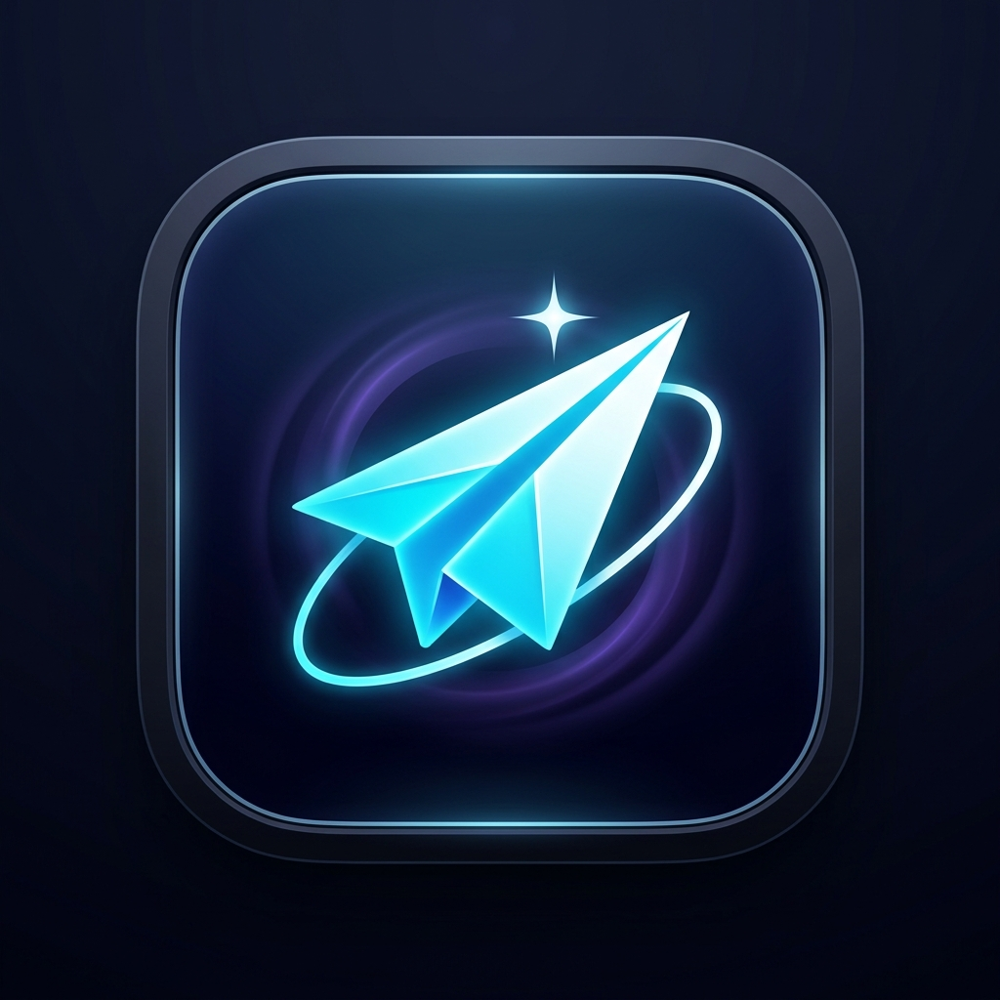

<div align="center">
  

  # Antigravity Telegram Remote Bridge
  ### Enterprise Headless AI Assistant & Development Controller

  [](https://python.org)
  [](https://github.com)
  [](https://core.telegram.org/bots)
  [](LICENSE)

  <p align="center">
    <strong>Control, prompt, and orchestrate Google Antigravity directly from your phone or browser via Telegram.</strong><br>
    Features real-time token streaming, voice note transcription, multi-project workspace switching, and zero GUI interference.
  </p>
</div>

---

## ⚡ Key Highlights

- 🛡️ **100% Headless Engine (`agy`):** Zero simulated mouse clicks, zero keyboard pasting, and zero window stealing. Executes natively in the background even when your PC is locked, minimized, or gaming.
- ⚡ **Real-Time Token Streaming:** Dynamically streams thought reasoning, token deltas, and tool updates (`⚙️ Tool: write_to_file...`) straight into your Telegram messages via `stream-json`.
- 🎙️ **Voice Note Prompts:** Send a voice note from your phone while walking or commuting. The bridge auto-transcribes your voice using speech recognition and executes the prompt hands-free.
- 📂 **Instant Workspace Switching:** Use `/projects` or `/cd <project>` to seamlessly hop between repositories and sub-projects from Telegram.
- 🎨 **AI Image Generation:** Generate images via `image-generator` and have the artwork delivered directly into your chat.
- 📦 **Automatic File & Artifact Delivery:** Created scripts, configs, and build files are sent to your phone as downloadable attachments.
- 🌿 **Mobile DevOps & Shell Runner:** Check `/git status`, review diffs, or execute arbitrary terminal commands (`/run <cmd>`) remotely.
- 🔒 **Single-User Security Lock:** Automatically locks and binds to your Telegram account upon first `/start`—rejecting all unauthorized access.

---

## ⚡ 1-Line Quick Install (Zero Git Cloning Needed)

Run one command in your terminal. It installs the bridge, sets up dependencies, and launches the interactive setup wizard:

### 🪟 Windows (PowerShell)
```powershell
irm https://raw.githubusercontent.com/DominceAseberos/Antigravity-Telegram-bridge/main/install.ps1 | iex
```

### 🍎 macOS & 🐧 Linux (Terminal)
```bash
curl -fsSL https://raw.githubusercontent.com/DominceAseberos/Antigravity-Telegram-bridge/main/install.sh | bash
```

> **What it does:** Installs to `~/.antigravity-telegram-bridge`, configures dependencies, runs the interactive setup wizard, and creates a global `antigravity-bridge` command and Desktop Shortcut with custom icon!

---

## 📦 Installation Options

### 1️⃣ Pip Install (Any OS with Python)
Install directly from GitHub as a global command on Windows, macOS, or Linux:
```bash
pip install git+https://github.com/DominceAseberos/Antigravity-Telegram-bridge.git
```
Then simply run:
```bash
antigravity-bridge --setup
```

---

### 2️⃣ 1-Line Terminal Installers (Automated Setup)

#### 🪟 Windows (PowerShell)
```powershell
irm https://raw.githubusercontent.com/DominceAseberos/Antigravity-Telegram-bridge/main/install.ps1 | iex
```

#### 🍎 macOS & 🐧 Linux (Terminal)
```bash
curl -fsSL https://raw.githubusercontent.com/DominceAseberos/Antigravity-Telegram-bridge/main/install.sh | bash
```

> **What it does:** Clones to `~/.antigravity-telegram-bridge`, installs dependencies, registers global commands (`antigravity-bridge` and `agy-bridge`), and starts the setup wizard.

---

### 3️⃣ Local Clone / Development Install
```bash
git clone https://github.com/DominceAseberos/Antigravity-Telegram-bridge.git
cd Antigravity-Telegram-bridge
pip install -e .
antigravity-bridge --setup
```

---

## 💻 CLI Commands (Run from Any Terminal)

Once installed, you can use these commands from **any folder** on your machine:

| Command | Description |
| :--- | :--- |
| **`antigravity-bridge`** | Starts the Telegram bridge background server |
| **`agy-bridge`** | Short alias for `antigravity-bridge` |
| **`antigravity-bridge status`** | Displays active config, bot token status, and AGY engine state |
| **`antigravity-bridge setup`** | Launches the interactive Telegram token & shortcut wizard |
| **`antigravity-bridge doctor`** | Runs diagnostic health check on Python, agy binary, and Telegram |
| **`antigravity-bridge --version`** | Displays the current bridge version |

---

## 📱 Mobile Command Cheatsheet

| Command | Action |
| :--- | :--- |
| `any text` | Executes prompt in active workspace with live streaming |
| 🎙️ `Voice Note` | Transcribes audio and runs instructions hands-free |
| 📸 `Photo` | Analyzes image and processes visual request |
| `/projects` | Opens 1-tap menu of all local workspaces |
| `/cd <project>` | Switches active working directory to chosen project |
| `/new [prompt]` | Starts a fresh conversation context |
| `/model [name]` | Switches model (`flash`, `argon`, `sonnet`, `opus`) |
| `/git [args]` | Runs git commands (`/git status`, `/git diff`, etc.) |
| `/run <command>` | Executes shell command (`/run npm test`, `/run dir`) |
| `/file <name>` | Downloads any project file directly to Telegram |
| `/status` | Displays PC RAM, battery, active model, and session ID |
| `/stop` | Aborts currently running AGY task immediately |
| `/keyboard` | Pins 1-tap quick buttons to your mobile chat bar |

---

## 🎛️ Architecture Overview

```mermaid
flowchart TD
    subgraph MobileDevice["📱 User Client (Phone / Telegram Web)"]
        A["Telegram Chat (Prompts, Voice, Photos, Commands)"]
    end

    subgraph BridgeCore["⚡ Telegram Remote Bridge Daemon"]
        B["telegram_bot.py (Polling & Router)"]
        C["agy_engine.py (Headless Execution)"]
        D["Voice Decoder (imageio-ffmpeg + SpeechRecognition)"]
        E["Live Streamer (stream-json Debouncer)"]
    end

    subgraph AntigravityEngine["🧠 Local Machine & Antigravity Core"]
        F["agy.exe / agy CLI Runtime"]
        G["Active Workspace (Projects / Repositories)"]
        H["image-generator Subagent & Code Tools"]
    end

    A <-->|HTTPS Bot API| B
    B -->|Audio| D
    D -->|Text| C
    B <-->|Events & Prompts| C
    C <-->|STDIN / STDOUT (stream-json)| F
    F <--> G
    F <--> H
    C -->|Real-Time Edits & Artifacts| E
    E -->|editMessageText & sendDocument| A
```

---

## 🖥️ Cross-Platform Execution

### Windows
Double-click the **Desktop App Shortcut** or run:
```bat
run_bridge.bat
```

### macOS & Linux
Make executable and launch the daemon loop:
```bash
chmod +x run_bridge.sh
./run_bridge.sh
```

---

## ⚖️ License & Trademarks

- **License:** Released under the [MIT License](LICENSE).
- **Disclaimer:** This is an independent, community-driven open-source project. *Antigravity* and *Gemini* are trademarks of Google LLC. This project is not affiliated with or endorsed by Google.
